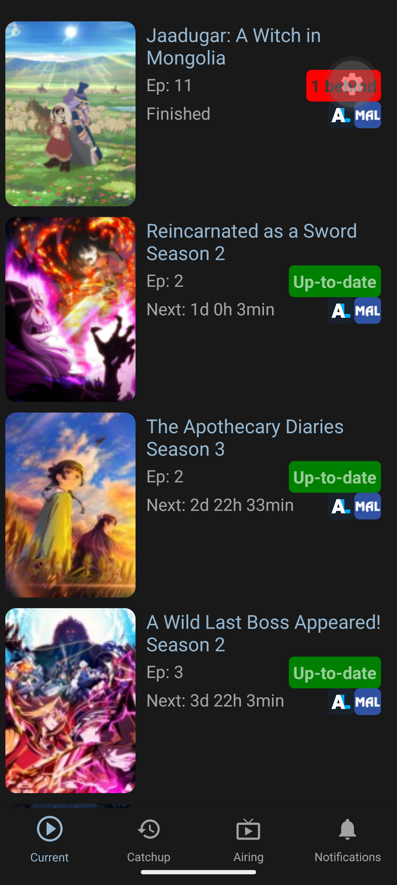

# Anime-Tracker

React native mobile app to track anime you are currently watching using the Anilist api.
Requires an Anilist account to work.

Distinguishes between anime that are currently airing and 'Catchup' anime (and anime turns into a 'Catchup anime about 1.5 months after it finished airing).

Also tracks anime that are currently airing (or will start airing soon), but the user isn't watching yet.

Finally also tracks notifications (like reactions to activity from other Anilist users, new aditions to the database or notifications about anime that started airing)

